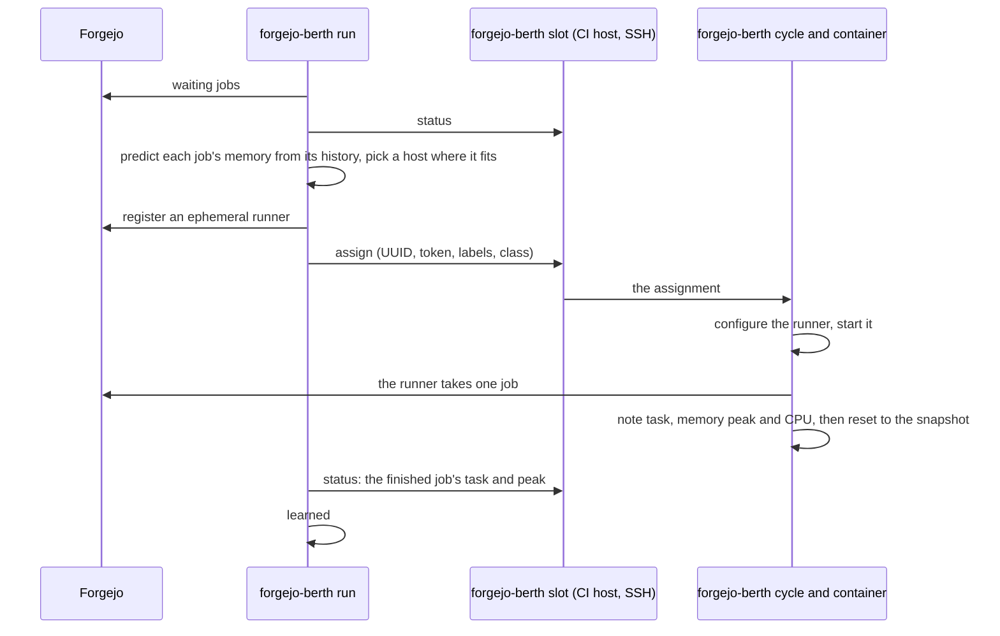

# forgejo-berth

forgejo-berth gives every waiting [Forgejo Actions](https://forgejo.org/docs/latest/user/actions/)
job an ephemeral runner of its own, on a container slot of a **fixed host you already have**,
admitted by the job's **learned memory peak**.

It registers a one-job runner just in time, hands it to a slot whose container was reset for
that job alone, and learns from the slot afterwards how much memory (and CPU) the job needed.
The next run of that job is packed onto the hosts by what it needed last time, so several jobs
share a host when they fit and wait when they would not.

## Is it for you?

forgejo-berth fills a gap. Most autoscalers for Forgejo runners create machines on demand:

| Project                                                                           | What it does                                      |
| --------------------------------------------------------------------------------- | ------------------------------------------------- |
| [fj-bellows](https://github.com/hstern/fj-bellows)                                | a cloud VM per job                                |
| [forgejo-autoscale-runner](https://codeberg.org/benoitc/forgejo-autoscale-runner) | VM pools on Scaleway, OVH and Hetzner Cloud       |
| [KEDA's Forgejo scaler](https://keda.sh/docs/latest/scalers/forgejo/)             | Kubernetes workloads scaled by pending jobs       |
| **forgejo-berth**                                                                 | per-job runners packed onto fixed hosts by memory |

Use one of the others when you want machines created and destroyed per job. Use forgejo-berth
when your CI runs on a few hosts you keep anyway (a dedicated server, a machine at home, spare
capacity), and you want:

- a clean container per job, with no runner token living on the host between jobs;
- several jobs per host where they fit, and no job starting where it would run out of memory;
- trusted owners whose jobs may get more powerful labels (for example host-mode execution),
  while everyone else's jobs get shared, containerised labels only.

## How it works



- **One binary.** `forgejo-berth run` is the broker. How it reaches the slots is its provider:
  - `docker`: the slots are containers on a Docker Engine (the broker's own, or remote ones),
    made for each job and removed after it. Nothing to install on the engine's host;
  - `incus`: the slots are Incus containers, restored from a snapshot before every job, reached
    through the Incus API. Nothing but Incus on the hosts;
  - `ssh`: on each CI host, `forgejo-berth slot` is the forced command of the broker's SSH
    key and `forgejo-berth cycle <container>` resets one Incus container around every job.
- **Learning.** The estimate for a job is the largest peak of its last 5 runs or of its runs
  within 30 days, times 1.2. A job without runs of its own borrows from its matrix family
  (`build (32)` from `build (31)`) or its repository, times 1.5. A job of an unknown
  repository gets 6 GiB, or a host alone. Runs are kept 180 days.
- **Order.** Jobs go in the order they arrived. A runner reserves for every job Forgejo may
  hand it: the oldest waiting job its scope and labels cover, which for a global runner can be
  an owner's job, or an older one if it asks before the runners started for those. A job that
  does not fit lets smaller ones pass for 10 minutes, then holds a host until it fits.
- **CPU.** Every job's average cores and CPU pressure are recorded. An optional rule keeps a
  host's predicted cores within its cores times an overcommit factor, or caps its jobs.

The full design, including the rules' reasons, is in [docs/design.md](docs/design.md).

## Quick start

Download a release archive (linux amd64 or arm64), check it against `checksums.txt`, and put
`forgejo-berth` in `/usr/local/bin` on the broker's host.

**On Forgejo** (17 or later): an admin token with `write:admin` and `read:repository`, and for
each trusted owner a token of theirs with `write:user`.

### One machine with Docker

The simplest setup: the broker and its slots on one machine with Docker (rootless Docker and
Podman's Docker-compatible socket work too). Each job gets a runner container of its own, made
from the runner's image, and a Docker of its own beside it for the job's containers; both are
removed after the job. Write `/etc/forgejo-berth/config.yml`:

```yaml
forgejo:
  url: https://forgejo.example.org
  admin_token_file: admin.token
shared:
  labels: [docker]
hosts:
  - name: local
    address: unix:///var/run/docker.sock
    memory_mib: 6000
    slots: [a, b]
provider:
  type: docker
  docker:
    labels:
      shared: {docker: "docker:docker://node:24-trixie"}
```

then check it and run it, as a user that may use the socket
([examples/forgejo-berth.service](examples/forgejo-berth.service); add the user to the
`docker` group, or point `address` at a rootless engine's socket):

```sh
forgejo-berth check --config /etc/forgejo-berth/config.yml
forgejo-berth run --config /etc/forgejo-berth/config.yml
```

A job with `runs-on: docker` now gets a runner named `berth-…`. Read
[Docker slots](#docker-slots) before giving the slots more than throwaway jobs:
[examples/config-docker.yml](examples/config-docker.yml) has every setting, remote engines
included.

### Incus hosts through the Incus API

The hosts need Incus alone. On each, make the containers as in step 1 below (a runner unit,
a snapshot), let the API listen (`incus config set core.https_address :8443`) and trust the
broker's client certificate (`incus config trust add-certificate broker.crt`). On the
broker's host, write the configuration
([examples/config-incus.yml](examples/config-incus.yml): the hosts' `https://` addresses and
`slots`, the server's certificate to pin, the runner's configuration template), check it and
run it as below. Incus on the broker's own host can be reached through its socket
(`unix:///var/lib/incus/unix.socket`).

### Incus hosts over SSH

Put `forgejo-berth` on every CI host too.

**On each CI host** (Incus):

1. Make the containers: each runs `forgejo-runner one-job` as a systemd unit, the runner's
   configuration written from a template (see
   [examples/runner-config.yml](examples/runner-config.yml)). Snapshot each one clean (`incus
   snapshot create ci-a clean`).
2. Write a slot file per container into `/etc/forgejo-berth/slots/`
   ([examples/slot.yml](examples/slot.yml)) and start
   `forgejo-berth-cycle@<container>.service`
   ([examples/forgejo-berth-cycle@.service](examples/forgejo-berth-cycle@.service)).
3. Add an account (here `berth`) whose one key is the broker's, forced to the slot command:

   ```text
   restrict,from="192.0.2.10",command="sudo -n /usr/local/bin/forgejo-berth slot -- \"$SSH_ORIGINAL_COMMAND\"" ssh-ed25519 AAAA… forgejo-berth
   ```

   and let it run that command as root ([examples/sudoers](examples/sudoers)).

**On the broker's host:** write `/etc/forgejo-berth/config.yml`
([examples/config.yml](examples/config.yml)), put the hosts' keys into its `known_hosts_file`,
check it, try it in shadow mode, then run it
([examples/forgejo-berth.service](examples/forgejo-berth.service)):

```sh
forgejo-berth check --config /etc/forgejo-berth/config.yml
forgejo-berth run --config /etc/forgejo-berth/config.yml --shadow
systemctl enable --now forgejo-berth
curl -s http://127.0.0.1:9877/state
```

## Configuration

One YAML file. Unknown keys are errors. Secrets are files, never arguments: a relative secret
path is looked up in `$CREDENTIALS_DIRECTORY` when set (systemd's `LoadCredential`).

| Key                               | Default                                 | Meaning                                                                                 |
| --------------------------------- | --------------------------------------- | --------------------------------------------------------------------------------------- |
| `forgejo.url`                     | required                                | the instance                                                                            |
| `forgejo.admin_token_file`        | required                                | admin token: waiting jobs, global runners, runs' jobs                                   |
| `trusted.owners`                  | none                                    | owner name to the file of their `write:user` token                                      |
| `trusted.labels`                  | none                                    | labels a trusted owner's job may ask for, besides host features                         |
| `shared.labels`                   | none                                    | labels everyone else's jobs may ask for (global runners)                                |
| `hosts[].name`                    | required                                | lowercase letters, digits, dashes                                                       |
| `hosts[].address`                 | required                                | where SSH reaches it                                                                    |
| `hosts[].memory_mib`              | required                                | memory its slots' jobs may use together                                                 |
| `hosts[].features`                | none                                    | labels only this host offers                                                            |
| `hosts[].cpu_cores`               | 0                                       | its cores, for `cpu.overcommit`                                                         |
| `hosts[].max_jobs`                | 0 (no cap)                              | jobs at once                                                                            |
| `hosts[].slots`                   | required for `docker`, `incus`          | the slots' names (Incus: the containers'); an SSH host lists its own                    |
| `hosts[].tls`                     | the provider's                          | its own `ca_file`, `cert_file`, `key_file` (`docker`, `incus`)                          |
| `hosts[].config_template`         | the provider's                          | its own runner configuration template (`docker`, `incus`)                               |
| `hosts[].labels`                  | the provider's                          | per class, its own label table (`docker`, `incus`)                                      |
| `provider.type`                   | `ssh`                                   | `ssh`, `docker` or `incus`                                                              |
| `provider.ssh.user`               | `berth`                                 | the CI hosts' account                                                                   |
| `provider.ssh.port`               | 22                                      |                                                                                         |
| `provider.ssh.key_file`           | ssh's default                           | the broker's private key                                                                |
| `provider.ssh.known_hosts_file`   | ssh's default                           | host keys; checking is always strict                                                    |
| `provider.ssh.control_dir`        | none                                    | keeps connections open between looks                                                    |
| `provider.ssh.timeout_seconds`    | 20                                      | connect timeout; a request gets three times that                                        |
| `provider.docker.image`           | `data.forgejo.org/forgejo/runner:13`    | the runner's image: `sh` and `forgejo-runner` on its PATH                               |
| `provider.docker.forgejo_url`     | `forgejo.url`                           | the instance as the runners reach it                                                    |
| `provider.docker.job_engine`      | `dind`                                  | `dind`, `none` or `host-socket` (see [Docker slots](#docker-slots))                     |
| `provider.docker.dind_image`      | `docker.io/library/docker:29-dind`      | the slot's own Docker                                                                   |
| `provider.docker.dind_args`       | none                                    | more `dockerd` arguments (a registry mirror)                                            |
| `provider.docker.host_socket`     | `/var/run/docker.sock`                  | the engine's socket on its host, for `host-socket`                                      |
| `provider.docker.user`            | the image's                             | the runner container's user (`uid[:gid]`)                                               |
| `provider.docker.network`         | the engine's default                    | a network the runner and its Docker join                                                |
| `provider.docker.labels`          | required                                | per class, label name to runner label                                                   |
| `provider.docker.config_template` | none                                    | the runner's configuration, with `@@RUNNER_UUID@@`, `@@RUNNER_LABELS@@`                 |
| `provider.docker.cache_volumes`   | none                                    | per class, a volume at `cache_path`; `{host}`, `{slot}`: [each slot's](#cache-volumes)  |
| `provider.docker.cache_path`      | `/var/cache/forgejo-runner`             |                                                                                         |
| `provider.docker.tls`             | none                                    | `ca_file`, `cert_file`, `key_file`: required for `tcp://` engines                       |
| `provider.docker.state_dir`       | `slots/` beside the history             | the slots' state, per host                                                              |
| `provider.docker.idle_hours`      | 24                                      | a ready slot is reset after that                                                        |
| `provider.docker.job_hours`       | 4                                       | a job is cut after that                                                                 |
| `provider.docker.boot_timeout`    | 300                                     | seconds for the slot's Docker to answer                                                 |
| `provider.docker.timeout_seconds` | 20                                      | one API request                                                                         |
| `provider.incus.tls`              | none                                    | `ca_file` (the server's certificate, pinned, or a CA), `cert_file`, `key_file`          |
| `provider.incus.project`          | `default`                               | the containers' project                                                                 |
| `provider.incus.snapshot`         | `clean`                                 | restored before every job                                                               |
| `provider.incus.config_template`  | required (or every host's)              | the runner's configuration, on the broker's host                                        |
| `provider.incus.config_path`      | `/etc/forgejo-runner/config.yml`        | as in a slot file ([examples/slot.yml](examples/slot.yml))                              |
| `provider.incus.token_path`       | `/etc/forgejo-runner/token`             | as in a slot file                                                                       |
| `provider.incus.runner_service`   | `forgejo-runner`                        | as in a slot file                                                                       |
| `provider.incus.runner_user`      | `runner`                                | as in a slot file                                                                       |
| `provider.incus.work_dir`         | `/var/lib/forgejo-runner/work`          | as in a slot file                                                                       |
| `provider.incus.cache_pool`       | `default`                               | as in a slot file                                                                       |
| `provider.incus.labels`           | required                                | as for `docker`                                                                         |
| `provider.incus.cache_volumes`    | none                                    | per class, an Incus volume at `cache_path`; as for `docker`                             |
| `provider.incus.…`                | as for `docker`                         | `cache_path`, `state_dir`, `idle_hours`, `job_hours`, `boot_timeout`, `timeout_seconds` |
| `estimate.history_runs`           | 5                                       | the last runs that count                                                                |
| `estimate.spike_days`             | 30                                      | runs within that many days count too                                                    |
| `estimate.margin`                 | 1.2                                     | on the job's own peak                                                                   |
| `estimate.relative_margin`        | 1.5                                     | on a family's or repository's peak                                                      |
| `estimate.floor_mib`              | 512                                     | the least reserved                                                                      |
| `estimate.unknown_mib`            | 6144                                    | for a job without history; 0: a host alone                                              |
| `estimate.retention_days`         | 180                                     | runs older are forgotten                                                                |
| `cpu.overcommit`                  | 0 (off)                                 | predicted cores within `cpu_cores` times this                                           |
| `cpu.unknown_cores`               | 1                                       | cores predicted for a job without CPU history                                           |
| `history.path`                    | `/var/lib/forgejo-berth/history.sqlite` | runs and kept assignments                                                               |
| `interval_seconds`                | 10                                      | between looks                                                                           |
| `unused_minutes`                  | 15                                      | a runner without a job is stopped after that                                            |
| `starve_minutes`                  | 10                                      | a job that fits nowhere then holds a host                                               |
| `runner_prefix`                   | `berth-`                                | runner names; the sweep deletes only these                                              |
| `listen`                          | none                                    | address of `/metrics`, `/state`, `/healthz`                                             |
| `state_file`                      | none                                    | the state document, written after every look                                            |
| `metrics_file`                    | none                                    | the metrics, written after every look (node_exporter textfile)                          |
| `shadow`                          | false                                   | compute and log, act on nothing                                                         |
| `log.format`, `log.level`         | `text`, `info`                          | `json`; `debug`, `warn`, `error`                                                        |

The 6 GiB for an unknown job is enough for a typical container build, while a host of 12 GiB
or more still runs something beside it. The margins cover a run that needs somewhat more than
the largest seen; an underestimate is learned at once and counted.

## Docker slots

With the `docker` provider, a host is a Docker Engine: `unix:///path` (the broker's host), or
`tcp://host:2376` with TLS and a client certificate (`provider.docker.tls`, the key a secret
file; a host's own `tls` in place of any of its files). The slots' reset cycles run in the
broker; their state is in `state_dir`, so a restart of the broker leaves running jobs alone and
takes them up again. For each job, a slot makes:

- `<runner_prefix><host>-<slot>`: the runner's container, from `image`, running
  `forgejo-runner one-job` for the assigned runner (its token in a file of the container,
  readable by the runner's user alone). It outlives the runner briefly, so its cgroup can be
  read after the job;
- with `job_engine: dind`, `<…>-docker`: a Docker of the slot's own (`dind_image`), whose
  socket the runner reaches through the volume `<…>-run`. The job's containers run there.

Both, and the volume, are removed before the next job. The job's peak is the sum of both
containers' `memory.peak` (plus swap), read from their cgroups (cgroup v2; on cgroup v1 the
stats API's `max_usage`), its CPU use from their `cpu.stat` and `cpu.pressure`.

What a job can reach depends on `job_engine`:

| `job_engine`  | The job's containers run on                       | What the job is given                                       |
| ------------- | ------------------------------------------------- | ----------------------------------------------------------- |
| `dind`        | a Docker of the slot's own, removed after the job | a privileged container on the engine; see below             |
| `none`        | nothing: host-mode labels only (`label:host`)     | the runner's container                                      |
| `host-socket` | the engine the slots run on                       | **control of that engine**: every container on it, the host |

- `dind` is the default. The slot's Docker runs privileged, as Docker in Docker must; the
  job's code runs in containers inside it, not in the privileged container itself. A privileged
  container on a rootful engine is root on the host to whoever escapes it; on a rootless engine
  (or Podman without root) it is the engine's user. Prefer a rootless engine for jobs you do not
  trust. Each job's Docker starts empty: images are pulled for every job (a registry mirror
  in `dind_args` saves that).
- `host-socket` is an explicit opt-in for trusted jobs only. **A job with the engine's socket
  can start a privileged container, mount the host's root, read the other slots' tokens and
  stop the broker's containers: on a rootful engine that is root on the host.** Its containers
  are siblings of the slots, so their memory is not part of the job's peak, and nothing
  removes what the job leaves on the engine. The runner's user must be able to use the
  socket (`user`).

## Incus slots

With the `incus` provider, a host is an Incus server: `https://host:8443` with the broker's
client certificate (the server's own certificate in `tls.ca_file` is pinned: it must present
exactly that one; a server with a certificate of its own has it in its host's `tls.ca_file`), or
`unix:///var/lib/incus/unix.socket`. A slot is a container of `hosts[].slots`, as with the SSH
provider; its reset cycle runs in the broker and does the same through the API: stop, restore
the snapshot, start, wait for systemd; attach the class's cache volume, push the runner's
configuration and token through the file API, start the runner; watch it with `exec` (its cgroup
seen from inside); after the job, the peak from the instance's state (`memory.usage_peak` plus
`swap_usage_peak`; the container's own `memory.peak` where the server reports none), the CPU
from its cgroup. The state is in `state_dir`, as for Docker. The runner's journal is in the
broker's log at debug level.

## Cache volumes

`cache_volumes` gives the runner a volume at `cache_path` that outlives the slot's reset, per
class (`trusted`, `shared`): the runner's caches (its `actions/cache` server's store, set in its
configuration) then last from one job to the next. A plain name is one volume for every slot of
a host, which their jobs use at the same time. With `{slot}` (and `{host}`) in the name, each
slot has a volume of its own:

```yaml
cache_volumes:
  trusted: berth-cache-{host}-{slot}-trusted
  shared: berth-cache-{host}-{slot}-shared
```

`{host}` is the host's name, `{slot}` the slot's (an Incus slot's container); in an SSH host's
slot file, `{slot}` is the container and `{host}` the host's own short name. A volume that is not
there is made at its first use, empty: a Docker named volume (with the labels
`org.forgejo-berth.host` and `org.forgejo-berth.cache`, its class), or an Incus custom volume
in `cache_pool`. berth never removes one: a slot taken out of the configuration leaves its
volume behind, for `docker volume rm` or `incus storage volume delete`.

## Slot protocol

The broker runs these commands over SSH (`pause` and `resume` for `forgejo-berth pause`); the
host's key forces `forgejo-berth slot`, which takes the requested command as its one argument
(or from `SSH_ORIGINAL_COMMAND`). Put `--` before the argument, as above: a request after `--`
is never taken for a flag, whatever it begins with (without it, one beginning with `-` would be
parsed as the command's flags).

| Command                            | Input           | Output                                               |
| ---------------------------------- | --------------- | ---------------------------------------------------- |
| `status`                           | none            | JSON: the slots and their last finished job          |
| `assign <container>`               | assignment JSON | the assignment id; exit 1 when refused               |
| `release <container> <assignment>` | none            | exit 1 when the slot does not hold it                |
| `pause <container> [stop]`         | none            | the slot's state ([Pausing a slot](#pausing-a-slot)) |
| `resume <container>`               | none            | the slot's state                                     |

```json
{"slots": [{"container": "ci-a", "state": "ready", "state_since": 1763700000,
  "assignment": "",
  "last": {"assignment": "ci-1-ci-a-1763699000-42", "task": 8480, "peak_mib": 2345,
           "seconds": 312.5, "cpu_cores": 1.85, "cpu_pressure": 0.12}}]}
```

```json
{"assignment": "ci-1-ci-a-1763700000-42", "uuid": "0f0e0d0c-0b0a-4908-8706-050403020100",
 "token": "<runner token>", "labels": ["ubuntu-latest"], "class": "trusted", "unused_minutes": 15}
```

States: `ready`, `pending` (written, not taken yet), `assigned`, `running`, `resetting`,
`failed`, `stopped`, `paused`; `"paused": true` while a slot is paused or pausing. The class
(`trusted` for owners' runners, `shared` for global ones) selects the slot's own label table:
the slot maps label names to runner labels, so a shared runner never gets a trusted label,
whatever it is sent. Every field's check is in
[docs/design.md](docs/design.md#slot-protocol-ssh).

## Pausing a slot

A slot can be taken out of service without stopping the broker, for instance while its
container is reconfigured:

```sh
forgejo-berth pause --config /etc/forgejo-berth/config.yml ci-1/ci-a          # after its job
forgejo-berth pause --config /etc/forgejo-berth/config.yml --stop ci-1/ci-a   # at once
forgejo-berth resume --config /etc/forgejo-berth/config.yml ci-1/ci-a
```

A paused slot takes no new assignment. A runner it holds that has no job yet is stopped (the
broker starts another one elsewhere); a job it runs runs to its end, or with `--stop` is cut at
once. Then the slot is reset as after every job and stays `paused`: an Incus container restored
and running, untouched until it is resumed; a Docker slot without containers. Resumed, it is
reset again (an Incus container restored from its snapshot, which may be a new one) and is
`ready`. The slot reports `paused` in its state and in `forgejo_berth_cycle_state`.

The pause is a file beside the slot's state (`<state_dir>/[<host>/]<slot>.pause`), so it
survives a restart of the broker or of the cycle: a slot still paused is left as it is, not
reset. With the `docker` and `incus` providers `forgejo-berth pause` writes it into the
broker's `state_dir` (run it as the broker's user); with `ssh` it asks the host's slot command,
which can be run on the host as well (`forgejo-berth slot -- "pause ci-a"`). An SSH host's
default `state_dir` is under `/run`: a pause there does not survive the host's reboot unless
`state_dir` is on disk.

## Observability

- `GET /metrics`: `forgejo_berth_last_tick_seconds`, `forgejo_berth_waiting_jobs{kind}`,
  `forgejo_berth_host_reachable{host}`, `forgejo_berth_reserved_mib{host}`,
  `forgejo_berth_events_total{event}` (`assigned`, `learned`, `unlearned`, `unused`, `failed`,
  `underestimated`, `released`, `would_assign`), `forgejo_berth_estimates{source}`,
  `forgejo_berth_jobs_learned`, `forgejo_berth_shadow`. Each slot's reset cycle has
  `forgejo_berth_cycle_state{container,state}`, `forgejo_berth_cycle_jobs_total{container}`,
  `forgejo_berth_cycle_failures{container}` and `forgejo_berth_cycle_last_reset_seconds{container}`:
  on an SSH host the cycle writes them to a node_exporter textfile directory when one is set
  (`textfile_dir`); with the `docker` and `incus` providers they are part of the broker's
  metrics (and `metrics_file`), with a `host` label.
- `GET /state`: the hosts' reachability and reservations, the assignments (no tokens), the
  counters and the estimates' sources, and the cycles the broker runs (`cycles`).
- `GET /healthz`: 200 while the last look is recent.
- Logs: structured (`log/slog`), one line per decision.

Alerts worth having: no look for 5 minutes; a host unreachable for 10; more than a few
`underestimated` a day (margins too small); `unlearned` without `learned` for hours (the
runner's task line changed).

## Security

- The broker holds the admin and owner tokens; a CI host holds none. A runner's token lives in
  the broker only until the slot has it, and on the host until the container's next reset.
  It is never logged, kept in the history or shown in the state. With the `docker` and
  `incus` providers the slot side is the broker's: the token waits in `state_dir` (0600) for
  a few seconds, until the slot's cycle takes it.
- Docker: see [Docker slots](#docker-slots) for what each `job_engine` grants a job. A remote
  engine is reached through TLS with a client certificate only.
- Incus: the broker's certificate is trusted by the servers, which gives it their whole API
  (restrict it to the slots' project with a restricted certificate,
  `incus config trust add-certificate --restricted --projects ci`). The server's certificate
  is pinned.
- SSH: strict host key checking, batch mode, the configured key only; the host forces one
  command that parses its arguments strictly.
- Trusted owners' runners are registered at their own user scope: they can only take their
  owner's jobs.

## Shadow mode

`--shadow` reads everything and acts on nothing: no runner registered, assigned, released or
deleted, nothing recorded. It opens the history read-only and reads the kept assignments at
every look, so it can point at the database of a live instance and log the decisions it would
take (`would assign`) next to the live ones.

## Building

```sh
go test -race ./...
CGO_ENABLED=0 go build -trimpath -o forgejo-berth ./cmd/forgejo-berth
scripts/dist.sh v0.1.0   # the release archives and checksums.txt in dist/
```

`scripts/real-forgejo.sh` runs the broker against a throwaway Forgejo and forgejo-runner in
Docker (rootless works), with slots that are runner containers: two owners' workflows run, the
broker learns their peaks and CPU use, and the next build reserves its own peak with the margin.
`scripts/real-forgejo.sh docker` runs the same through the docker provider, each job's
containers in a Docker of its slot's own.

## Licence

GPL-3.0-or-later. See [LICENSE](LICENSE).
