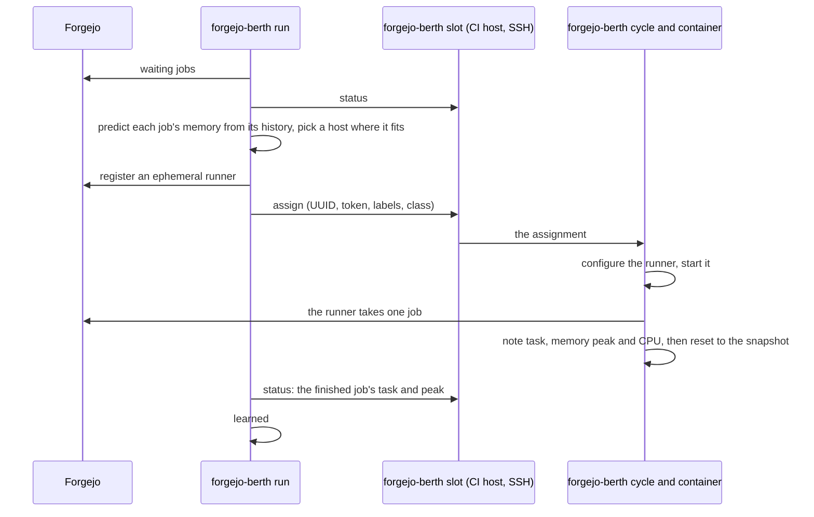

# forgejo-berth

forgejo-berth gives every waiting [Forgejo Actions](https://forgejo.org/docs/latest/user/actions/)
job an ephemeral runner of its own, on a container slot of a **fixed host you already have**,
admitted by the job's **learned memory peak**.

It registers a one-job runner just in time, hands it to a slot whose container was reset for
that job alone, and learns from the slot afterwards how much memory (and CPU) the job needed.
The next run of that job is packed onto the hosts by what it needed last time, so several jobs
share a host when they fit and wait when they would not.

## Is it for you?

forgejo-berth fills a gap. Most autoscalers for Forgejo runners create machines on demand:

| Project                                                               | What it does                                      |
| --------------------------------------------------------------------- | ------------------------------------------------- |
| [fj-bellows](https://github.com/hstern/fj-bellows)                    | a cloud VM per job                                |
| forgejo-autoscale-runner                                              | VM pools on Scaleway, OVH and Hetzner Cloud       |
| [KEDA's Forgejo scaler](https://keda.sh/docs/latest/scalers/forgejo/) | Kubernetes workloads scaled by pending jobs       |
| **forgejo-berth**                                                     | per-job runners packed onto fixed hosts by memory |

Use one of the others when you want machines created and destroyed per job. Use forgejo-berth
when your CI runs on a few hosts you keep anyway (a dedicated server, a machine at home, spare
capacity), and you want:

- a clean container per job, with no runner token living on the host between jobs;
- several jobs per host where they fit, and no job starting where it would run out of memory;
- trusted owners whose jobs may get more powerful labels (for example host-mode execution),
  while everyone else's jobs get shared, containerised labels only.

## How it works



- **One binary.** `forgejo-berth run` is the broker; on each CI host, `forgejo-berth slot` is
  the forced command of the broker's SSH key and `forgejo-berth cycle <container>` resets one
  Incus container around every job.
- **Learning.** The estimate for a job is the largest peak of its last 5 runs or of its runs
  within 30 days, times 1.2. A job without runs of its own borrows from its matrix family
  (`build (32)` from `build (31)`) or its repository, times 1.5. A job of an unknown
  repository gets 6 GiB, or a host alone. Runs are kept 180 days.
- **Order.** Jobs go in the order they arrived. A runner reserves for the job Forgejo will hand
  it: the oldest waiting job its scope and labels cover. A job that does not fit lets smaller
  ones pass for 10 minutes, then holds a host until it fits.
- **CPU.** Every job's average cores and CPU pressure are recorded. An optional rule keeps a
  host's predicted cores within its cores times an overcommit factor, or caps its jobs.

The full design, including the rules' reasons, is in [docs/design.md](docs/design.md).

## Quick start

Download a release archive (linux amd64 or arm64), check it against `checksums.txt`, and put
`forgejo-berth` in `/usr/local/bin` on the broker's host and on every CI host.

**On Forgejo** (17 or later): an admin token with `write:admin` and `read:repository`, and for
each trusted owner a token of theirs with `write:user`.

**On each CI host** (Incus):

1. Make the containers: each runs `forgejo-runner one-job` as a systemd unit, the runner's
   configuration written from a template (see [examples/runner-config.yml](examples/runner-config.yml)).
   Snapshot each one clean (`incus snapshot create ci-a clean`).
2. Write a slot file per container into `/etc/forgejo-berth/slots/`
   ([examples/slot.yml](examples/slot.yml)) and start
   `forgejo-berth-cycle@<container>.service`
   ([examples/forgejo-berth-cycle@.service](examples/forgejo-berth-cycle@.service)).
3. Add an account (here `berth`) whose one key is the broker's, forced to the slot command:

   ```text
   restrict,from="192.0.2.10",command="sudo -n /usr/local/bin/forgejo-berth slot \"$SSH_ORIGINAL_COMMAND\"" ssh-ed25519 AAAA… forgejo-berth
   ```

   and let it run that command as root ([examples/sudoers](examples/sudoers)).

**On the broker's host:** write `/etc/forgejo-berth/config.yml`
([examples/config.yml](examples/config.yml)), put the hosts' keys into its `known_hosts_file`,
check it, try it in shadow mode, then run it
([examples/forgejo-berth.service](examples/forgejo-berth.service)):

```sh
forgejo-berth check --config /etc/forgejo-berth/config.yml
forgejo-berth run --config /etc/forgejo-berth/config.yml --shadow
systemctl enable --now forgejo-berth
curl -s http://127.0.0.1:9877/state
```

## Configuration

One YAML file. Unknown keys are errors. Secrets are files, never arguments: a relative secret
path is looked up in `$CREDENTIALS_DIRECTORY` when set (systemd's `LoadCredential`).

| Key                                   | Default                                 | Meaning                                                              |
| ------------------------------------- | --------------------------------------- | -------------------------------------------------------------------- |
| `forgejo.url`                         | required                                | the instance                                                         |
| `forgejo.admin_token_file`            | required                                | admin token: waiting jobs, global runners, runs' jobs                |
| `trusted.owners`                      | none                                    | owner name to the file of their `write:user` token                   |
| `trusted.labels`                      | none                                    | labels a trusted owner's job may ask for, besides host features      |
| `shared.labels`                       | none                                    | labels everyone else's jobs may ask for (global runners)             |
| `hosts[].name`                        | required                                | lowercase letters, digits, dashes                                    |
| `hosts[].address`                     | required                                | where SSH reaches it                                                 |
| `hosts[].memory_mib`                  | required                                | memory its slots' jobs may use together                              |
| `hosts[].features`                    | none                                    | labels only this host offers                                         |
| `hosts[].cpu_cores`                   | 0                                       | its cores, for `cpu.overcommit`                                      |
| `hosts[].max_jobs`                    | 0 (no cap)                              | jobs at once                                                         |
| `provider.type`                       | `ssh`                                   | the slot provider                                                    |
| `provider.ssh.user`                   | `berth`                                 | the CI hosts' account                                                |
| `provider.ssh.port`                   | 22                                      |                                                                      |
| `provider.ssh.key_file`               | ssh's default                           | the broker's private key                                             |
| `provider.ssh.known_hosts_file`       | ssh's default                           | host keys; checking is always strict                                 |
| `provider.ssh.control_dir`            | none                                    | keeps connections open between looks                                 |
| `provider.ssh.timeout_seconds`        | 20                                      | connect timeout; a request gets three times that                     |
| `estimate.history_runs`               | 5                                       | the last runs that count                                             |
| `estimate.spike_days`                 | 30                                      | runs within that many days count too                                 |
| `estimate.margin`                     | 1.2                                     | on the job's own peak                                                |
| `estimate.relative_margin`            | 1.5                                     | on a family's or repository's peak                                   |
| `estimate.floor_mib`                  | 512                                     | the least reserved                                                   |
| `estimate.unknown_mib`                | 6144                                    | for a job without history; 0: a host alone                           |
| `estimate.retention_days`             | 180                                     | runs older are forgotten                                             |
| `cpu.overcommit`                      | 0 (off)                                 | predicted cores within `cpu_cores` times this                        |
| `cpu.unknown_cores`                   | 1                                       | cores predicted for a job without CPU history                        |
| `history.path`                        | `/var/lib/forgejo-berth/history.sqlite` | runs and kept assignments                                            |
| `interval_seconds`                    | 10                                      | between looks                                                        |
| `unused_minutes`                      | 15                                      | a runner without a job is stopped after that                         |
| `starve_minutes`                      | 10                                      | a job that fits nowhere then holds a host                            |
| `runner_prefix`                       | `berth-`                                | runner names; the sweep deletes only these                           |
| `listen`                              | none                                    | address of `/metrics`, `/state`, `/healthz`                          |
| `state_file`                          | none                                    | the state document, written after every look                         |
| `shadow`                              | false                                   | compute and log, act on nothing                                      |
| `log.format`, `log.level`             | `text`, `info`                          | `json`; `debug`, `warn`, `error`                                     |

The 6 GiB for an unknown job is enough for a typical container build, while a host of 12 GiB
or more still runs something beside it. The margins cover a run that needs somewhat more than
the largest seen; an underestimate is learned at once and counted.

## Slot protocol

The broker runs one of three commands over SSH; the host's key forces `forgejo-berth slot`,
which takes the requested command as its one argument (or from `SSH_ORIGINAL_COMMAND`).

| Command                            | Input           | Output                                      |
| ---------------------------------- | --------------- | ------------------------------------------- |
| `status`                           | none            | JSON: the slots and their last finished job |
| `assign <container>`               | assignment JSON | the assignment id; exit 1 when refused      |
| `release <container> <assignment>` | none            | exit 1 when the slot does not hold it       |

```json
{"slots": [{"container": "ci-a", "state": "ready", "state_since": 1763700000,
  "assignment": "",
  "last": {"assignment": "ci-1-ci-a-1763699000-42", "task": 8480, "peak_mib": 2345,
           "seconds": 312.5, "cpu_cores": 1.85, "cpu_pressure": 0.12}}]}
```

```json
{"assignment": "ci-1-ci-a-1763700000-42", "uuid": "0f0e0d0c-0b0a-4908-8706-050403020100",
 "token": "<runner token>", "labels": ["ubuntu-latest"], "class": "trusted", "unused_minutes": 15}
```

States: `ready`, `pending` (written, not taken yet), `assigned`, `running`, `resetting`,
`failed`, `stopped`. The class (`trusted` for owners' runners, `shared` for global ones)
selects the slot's own label table: the slot maps label names to runner labels, so a shared
runner never gets a trusted label, whatever it is sent. Every field's check is in
[docs/design.md](docs/design.md#slot-protocol-ssh).

## Observability

- `GET /metrics`: `forgejo_berth_last_tick_seconds`, `forgejo_berth_waiting_jobs{kind}`,
  `forgejo_berth_host_reachable{host}`, `forgejo_berth_reserved_mib{host}`,
  `forgejo_berth_events_total{event}` (`assigned`, `learned`, `unlearned`, `unused`, `failed`,
  `underestimated`, `released`, `would_assign`), `forgejo_berth_estimates{source}`,
  `forgejo_berth_jobs_learned`, `forgejo_berth_shadow`. The cycle writes
  `forgejo_berth_cycle_*` to a node_exporter textfile directory when one is set.
- `GET /state`: the hosts' reachability and reservations, the assignments (no tokens), the
  counters and the estimates' sources.
- `GET /healthz`: 200 while the last look is recent.
- Logs: structured (`log/slog`), one line per decision.

Alerts worth having: no look for 5 minutes; a host unreachable for 10; more than a few
`underestimated` a day (margins too small); `unlearned` without `learned` for hours (the
runner's task line changed).

## Security

- The broker holds the admin and owner tokens; a CI host holds none. A runner's token lives in
  the broker only until the slot has it, and on the host until the container's next reset.
  It is never logged, kept in the history or shown in the state.
- SSH: strict host key checking, batch mode, the configured key only; the host forces one
  command that parses its arguments strictly.
- Trusted owners' runners are registered at their own user scope: they can only take their
  owner's jobs.

## Shadow mode

`--shadow` reads everything and acts on nothing: no runner registered, assigned, released or
deleted, nothing recorded. It opens the history read-only and reads the kept assignments at
every look, so it can point at the database of a live instance and log the decisions it would
take (`would assign`) next to the live ones.

## Building

```sh
go test -race ./...
CGO_ENABLED=0 go build -trimpath -o forgejo-berth ./cmd/forgejo-berth
scripts/dist.sh v0.1.0   # the release archives and checksums.txt in dist/
```

## Licence

GPL-3.0-or-later. See [LICENSE](LICENSE).
