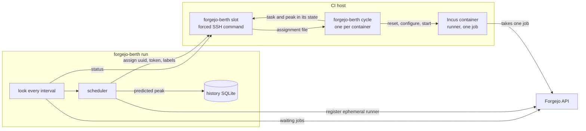
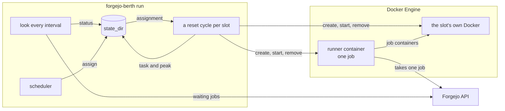

# forgejo-berth design

forgejo-berth gives every waiting Forgejo Actions job a runner of its own, on a fixed host
where the job's memory fits. It registers an ephemeral runner (one job, then Forgejo removes it
and its token) and hands it to a container slot that was reset for that job alone. It learns
each job's memory peak from the slot after the job, and uses the history to pack later jobs onto
the hosts.

It fills a gap. Other autoscalers create machines on demand: cloud VMs per job, VM pools, or
Kubernetes pods scaled by the number of pending jobs. forgejo-berth is for hosts you already
have and pay for, whatever load they carry: it decides which job runs where, and when a job
waits because it would not fit.

## Goals and non-goals

Goals:

- One runner per job, registered just in time, deleted when unused. No long-lived runner token
  on a CI host.
- Admission by learned memory: a job starts on a host only when its predicted peak fits beside
  the reservations of the jobs already running there.
- Trusted owners may get runners with more powerful labels (for example host-mode execution);
  everyone else gets the shared labels only.
- One static binary (`CGO_ENABLED=0`): the broker, the slot's forced command and the reset
  cycle.
- Usable without a fleet of one's own design: one machine with Docker is enough to start.
- A shadow mode that computes and logs decisions without acting, next to a live instance.

Non-goals:

- Creating or destroying machines. Use a cloud autoscaler for that (see the README).
- CPU scheduling as the first rule. Memory is what kills jobs and stalls hosts, so memory is
  what berth admits by. CPU use is recorded for every job, and an optional rule admits by it
  too ([CPU](#cpu)); it is off by default.
- Replacing Forgejo's own job order. Forgejo decides which job a runner gets; berth predicts
  that choice (see [Claims](#claims-and-reservations)).

## Architecture



That is the `ssh` provider. With the `docker` provider, the slot side runs in the broker itself
and reaches the containers through the engine's API (the `incus` provider alike, through the
Incus API, its slots Incus containers restored from a snapshot):



The broker is one loop. Every `interval_seconds` it:

1. asks every host for its slots (`Provider.Status`). A host that does not answer is marked
   unreachable; its slots get nothing, its assignments are kept;
2. settles each slot that finished an assignment: an unused runner is deleted; a runner that ran
   a job is looked up (which of its candidate jobs had that task id, and how it ended), and a job
   that ended `success` or `failure` is recorded with its peak;
3. forgets assignments no slot reports any more (after 90 seconds), and at once those on hosts
   removed from the configuration; their runners are deleted;
4. reads the waiting jobs (`GET /api/v1/admin/runners/jobs`), prunes the history once a day,
   releases idle runners none of whose jobs wait any more;
5. schedules: for each waiting job in arrival order, picks a slot and starts a runner there
   (register, keep the assignment, `Provider.Assign`);
6. publishes its state and metrics.

At start it sweeps the runners whose name has the configured prefix and that no kept assignment
holds (left by a crash between registering and keeping).

### Packages

| Package                    | Role                                                                                                      |
| -------------------------- | --------------------------------------------------------------------------------------------------------- |
| `cmd/forgejo-berth`        | subcommands `run`, `slot`, `cycle`, `check`, `version`                                                    |
| `internal/config`          | the broker's YAML configuration, defaults and validation                                                  |
| `internal/broker`          | jobs, slots, assignments; offer, predict, schedule; the loop                                              |
| `internal/history`         | SQLite: finished runs and the assignments held across restarts                                            |
| `internal/forgejo`         | the Forgejo API client (admin and owner tokens)                                                           |
| `internal/provider`        | the slot provider interface and the SSH provider                                                          |
| `internal/provider/docker` | the docker provider: the Engine API client and a slot's system                                            |
| `internal/provider/incus`  | the incus provider: the Incus API client and an API `Instance`                                            |
| `internal/slot`            | the slot side: the forced command, the reset cycle (Incus), and the slot side run in the broker (`Local`) |
| `internal/web`             | `/metrics`, `/state`, `/healthz`                                                                          |

## Slot provider interface

```go
type Provider interface {
    // Status lists the host's slots: state, current assignment, and the last finished
    // assignment with its task id, peak memory and duration.
    Status(ctx context.Context, host config.Host) ([]Slot, error)
    // Assign hands a ready slot a runner. An error means the slot refused; the broker then
    // deletes the runner.
    Assign(ctx context.Context, host config.Host, container string, h Handoff) error
    // Release asks the slot to stop the assignment's runner if it has no job yet.
    Release(ctx context.Context, host config.Host, container, assignment string) error
}
```

A finished slot's peak and task id are part of `Status` (the `last` object), so a slot needs no
separate query after its job: the broker reads them at the next look, before the slot takes a
new assignment.

Three providers implement it:

- `ssh`: every host is reached as one user whose authorized key forces `forgejo-berth slot`,
  and a `forgejo-berth cycle` per container runs on the host. The protocol is below.
- `docker`: every host is a Docker Engine; see [Docker provider](#docker-provider).
- `incus`: every host is an Incus server reached through its API; see
  [Incus provider](#incus-provider).

The `docker` and `incus` providers need nothing on the host. Their slot side runs in the
broker's process (`slot.Local`): the same reset cycle per slot, and the same `status`, `assign`
and `release` as the SSH slot command, on the same state files, kept in the broker's
`state_dir`, one directory per host. Only the cycle's `System`, the container as the cycle
reads and changes it, differs.

### Where the slot state lives

The SSH protocol keeps a slot's state on its host: the assignment waiting (`<slot>.assignment`),
the release (`<slot>.release`), and the cycle's state (`<slot>.json`: its state, the
assignment it serves, the last finished assignment with its task, peak, duration and CPU). A
provider without a host-side agent keeps the same files in the broker's `state_dir`
(default: `slots/` beside the history), and not on the containers:

- the cycle needs to write its state often (every state change, every job), and the broker is
  the only reader. Docker's labels cannot change after a container is made, and an Incus
  config key would cost an API request per change;
- the last finished assignment must outlive the container: a Docker slot's container is
  removed at the reset, and an Incus snapshot restore would roll a key back;
- one writer and one format for all providers keep the broker's view the same.

The containers carry what identifies them: a Docker slot's containers and volume have the
labels `org.forgejo-berth.host`, `org.forgejo-berth.slot` and, for the runner,
`org.forgejo-berth.assignment`.

A broker that stops leaves the slots as they are: the cycles end after their step, and no
container is reset. At the next start each cycle **resumes** from its state file: it keeps the
last finished assignment (which the broker may not have read yet), and takes up the assignment
it served. A runner still active is watched to its job's end; one that ended while no cycle
watched it is finished as it was, its time then counting the time without a cycle. A restart
of the broker (an upgrade, say) thus neither kills jobs nor loses what they taught.

A shadow broker starts no cycles: it reads the state files only, so it can point `state_dir`
at a live instance's.

### Slot states

| State       | Meaning                                                               |
| ----------- | --------------------------------------------------------------------- |
| `ready`     | reset, no runner, takes an assignment                                 |
| `pending`   | an assignment is written but the cycle has not taken it yet           |
| `assigned`  | the cycle took the assignment; the runner waits for its job           |
| `running`   | the runner runs its job                                               |
| `resetting` | the container is being restored from its snapshot                     |
| `failed`    | a reset or a runner start failed; the cycle backs off and tries again |
| `stopped`   | the cycle is not running                                              |

A slot is free only when it is `ready` with no assignment and no kept assignment of the broker
names it.

## Slot protocol (SSH)

The broker runs `ssh -o BatchMode=yes -o StrictHostKeyChecking=yes -i <key> -p <port>
<user>@<address> <command>`. The host's `authorized_keys` forces the command, for example:

```text
restrict,from="192.0.2.10",command="sudo -n /usr/local/bin/forgejo-berth slot \"$SSH_ORIGINAL_COMMAND\"" ssh-ed25519 AAAA…
```

`forgejo-berth slot` takes the whole requested command as one argument (or from
`SSH_ORIGINAL_COMMAND`) and knows three commands. Anything else exits 1 with a usage line.

`status` prints JSON on standard output. Tokens are never part of it.

```json
{"slots": [{"container": "ci-a", "state": "ready", "state_since": 1763700000,
  "assignment": "",
  "last": {"assignment": "ci-1-ci-a-1763699000-42", "task": 8480, "peak_mib": 2345,
           "seconds": 312.5, "cpu_cores": 1.85, "cpu_pressure": 0.12}}]}
```

`cpu_cores` and `cpu_pressure` are optional: a slot side that does not measure CPU omits them,
and the broker records no CPU figures for that run. `unused` is true for a runner that took no
job, and omitted otherwise.

`assign <container>` reads one assignment (JSON, at most 16 KiB) on standard input, checks it,
and writes it for the container's cycle (mode 0600). It prints the assignment id. It refuses
(exit 1, the reason on standard error) a container that is not a slot, a slot not `ready`, a slot
with an assignment already waiting, and an assignment out of shape.

```json
{"assignment": "ci-1-ci-a-1763700000-42", "uuid": "0f0e0d0c-0b0a-4908-8706-050403020100",
 "token": "<runner token>", "labels": ["ubuntu-latest"], "class": "trusted",
 "unused_minutes": 15}
```

| Field            | Check                                                        |
| ---------------- | ------------------------------------------------------------ |
| `assignment`     | `[a-z0-9][a-z0-9-]{0,127}`                                   |
| `uuid`           | a lowercase UUID                                             |
| `token`          | `[0-9A-Za-z_-]{20,256}`                                      |
| `class`          | `trusted` or `shared`, and configured on the slot            |
| `labels`         | not empty, every name in the class's label table of the slot |
| `unused_minutes` | 1 to 1440                                                    |

`release <container> <assignment>` asks the cycle to stop the assignment's runner if it still
has no job. It refuses a slot that does not hold that assignment.

The host maps label *names* to runner labels by the class's own table, so a shared runner can
never get a host label, whatever the broker sends. The broker sends names only.

## Reset cycle

`forgejo-berth cycle <container>` runs as root, one per container (a systemd template unit). Its
loop:

1. **reset**: drop any assignment not yet taken (its runner was deleted), stop the container,
   restore the snapshot, start it, wait for systemd in it to be `running` or `degraded`;
2. **ready**: wait for an assignment file; parse it as `slot assign` did. One out of shape is
   dropped. After `idle_hours` the container is refreshed (back to 1);
3. **assigned**: attach the class's cache volume, write the runner's configuration (a template
   with `@@RUNNER_UUID@@` and `@@RUNNER_LABELS@@`) and its token into the container, start the
   runner's service;
4. **running**: the runner took its job (a step's process, a host-mode job directory or a
   populated Docker scope under the runner's cgroup). A runner with no job after the
   assignment's `unused_minutes`, or released by the broker, is stopped, unless its journal shows
   it took a task (a job still pulling its image). A job longer than `job_hours` is cut;
5. **finish**: note the task id (the first `task N repo is` line of the runner's journal) and the
   container cgroup's `memory.peak` plus `memory.swap.peak` (rounded up to MiB) in the state's
   `last`, with the job's CPU use (see [CPU](#cpu)); then back to 1. The peak is the job's
   own: the container was started for it alone.

Failures back off from 30 seconds, doubling to 10 minutes. A SIGTERM ends the loop after the
step in progress and leaves the container as it is (`stopped`).

The state goes to `<state_dir>/<container>.json`; the assignment to `<container>.assignment`,
the release to `<container>.release`.

## Docker provider

A host's `address` is its engine: `unix:///path`, or `tcp://host:port` with TLS
(`provider.docker.tls`: the CA, the broker's client certificate and key). The client speaks the
Engine API with `net/http` (no SDK), without a version in the paths: an engine answers those
with its own version's shapes, and the fields used are the same since API 1.24, Podman's
Docker-compatible API included. A host also names its `slots`; slot `a` of host `ci-1` is
`<runner_prefix>ci-1-a`.

The reset cycle's steps, for a Docker slot:

1. **reset**: remove the slot's containers (with their anonymous volumes) and its volume; pull
   the runner's image (and the Docker image) when the engine does not have them;
2. **assigned**: with `job_engine: dind`, make the volume `<name>-run` and the slot's own
   Docker `<name>-docker` (`dind_image`, privileged, `dockerd` on a socket in that volume, no
   TCP listener), wait until it answers, and open the socket to the runner's user; then make
   the runner's container from `image`: an init, a small `sh` wrapper, and
   `forgejo-runner one-job --wait` with the assigned UUID, labels and `--token-url` of a file;
   copy the token (and the configuration from `config_template`, if any) into it, owned by
   the image's user, and start it;
3. **running**: the runner's log shows its task line. The wrapper forwards a stop signal to the
   runner, and when the runner exits writes a file and keeps the container up;
4. **finish**: the task from the log, and from the runner's container and the slot's Docker
   (whose cgroup holds the job's containers) their cgroups' `memory.peak` plus
   `memory.swap.peak`, summed, and their `cpu.stat` and `cpu.pressure`, read by `exec` in each
   container (cgroup v2 shows a container its own cgroup). Where there is no `memory.peak`
   (cgroup v1), the stats API's `max_usage`. The sum of the two peaks is a little above the
   peak of their sum: a margin on the safe side.

A job short enough to start and end between two looks of the cycle is still learned: the
runner's log shows its task (its CPU use is then not known).

`job_engine` is what the job's containers run on:

- `dind` (the default): the slot's own Docker, made for the job and removed after it. The job
  can do anything to that engine and nothing to the host's other containers. Docker in Docker
  needs a privileged container; on a rootless engine that is the engine user's privilege
  alone. A rootless Docker inside (`docker:dind-rootless`) needs more subordinate ids than a
  rootless engine has to give, so the rootful Docker image is the default;
- `none`: no engine; the labels must run on the host (`label:host`), in the runner's container;
- `host-socket`: the engine's own socket (`host_socket`) in the runner's container. Every job
  then controls that engine: every container on it, the other slots and their tokens, and on a
  rootful engine the host. Their containers are the engine's, not the slot's: their memory is
  not part of the job's peak, and nothing removes what a job leaves. An explicit opt-in, for
  trusted jobs only.

## Incus provider

The reset cycle's Incus logic (the boot wait and its diagnosis, the cache volume, the
runner's files, the journal's task line) drives an `Instance`, the container as that logic
reads and changes it. Two implement it:

| Operation    | `incus` command, on the host (SSH)               | Incus API, from the broker (`incus`)                       |
| ------------ | ------------------------------------------------ | ---------------------------------------------------------- |
| state        | `incus query /1.0/instances/<c>/state`           | `GET /1.0/instances/<c>/state`                             |
| stop, start  | `incus stop --force`, `incus start`              | `PUT …/state` (`action`, `force`), an operation waited for |
| restore      | `incus snapshot restore`                         | `PUT /1.0/instances/<c>` with `restore`                    |
| exec         | `incus exec <c> --`                              | `POST …/exec`, `record-output`; the records read, removed  |
| write a file | `sh -c 'cat > tmp…'` from standard input         | `POST …/files` (root, 0600), then `chgrp`, `chmod`, `mv`   |
| cache device | `incus config device remove/add`                 | `GET` the instance, `PUT` it back with `If-Match`          |
| its log      | `incus info --show-log`                          | `GET …/logs/lxc.log`                                       |
| the runner   | its cgroup and `/proc/<pid>/root`, from the host | one `exec` of a script reading the same from inside        |
| peak         | the cgroup's `memory.peak`, `memory.swap.peak`   | the state's `memory.usage_peak`, `swap_usage_peak`         |
| CPU          | the cgroup's `cpu.stat`, `cpu.pressure`          | the same files, read by `exec` from inside                 |

Inside a container, cgroup v2 with its cgroup namespace shows the container's own cgroup at
`/sys/fs/cgroup`, the tree the host sees under `lxc.payload.<c>`. The runner is looked at once
for both questions of a look (active, busy). An answer that does not come (the API away for a
moment) counts as active, not busy: the next look asks again, rather than ending a job that
runs. Where the state reports no peak (a kernel or server without `memory.peak`), the
container's own `memory.peak` is read from inside.

A host's `address` is `https://host:port`, with the broker's client certificate and the
server's certificate pinned (`tls.ca_file`: a certificate that is no CA must be the server's
exactly; a CA checks the chain and the name), or `unix:///path`, the local socket. The
broker's status of a host is a `GET /1.0` that must say `auth: trusted`. The client uses
`net/http` only; the response shapes are those of the Incus REST API (sync, async with an
operation waited for at `/1.0/operations/<id>/wait`, error).

## Configuration

One YAML file, `--config` (default `/etc/forgejo-berth/config.yml`). Secrets are files: the
admin token, each trusted owner's token, the SSH key. A relative secret path is looked up in
`$CREDENTIALS_DIRECTORY` when set (systemd `LoadCredential`), else in the working directory.
The command line takes no secret. The full reference is in the README.

```yaml
forgejo:
  url: https://forgejo.example.org
  admin_token_file: admin.token        # write:admin, read:repository
trusted:
  owners:
    alice: alice.token                 # write:user of alice
  labels: [ubuntu-latest, docker]
shared:
  labels: [docker]
hosts:
  - name: ci-1
    address: ci-1.example.org
    memory_mib: 14000
    features: [gpu]
provider:
  type: ssh
  ssh: {user: berth, port: 22, key_file: ssh_key,
        known_hosts_file: /etc/forgejo-berth/known_hosts}
```

## Who may get which runner

`offer(job)`:

- a job of a trusted owner gets a runner at that owner's user scope
  (`POST /api/v1/user/actions/runners` with the owner's token), with the labels it asks for, if
  each is a trusted label or a host feature; otherwise none;
- anyone else's job gets a global runner (`POST /api/v1/admin/actions/runners`) if each label it
  asks for is a shared label; otherwise none;
- a job asking for no label gets none.

Jobs no runner may take are counted (`unservable`) and left to other runners.

A job asking for a feature goes only to hosts that have it.

## Learning

The history keeps every learned run: repository, job name, family (the name without a trailing
matrix part: `build (32)` is of family `build`), time, peak MiB, reserved MiB (0 for a host
alone), seconds, host.

**Estimate.** For a job, the largest peak among its last `history_runs` (5) runs and its runs
within `spike_days` (30), whichever reach further back. A rare spike thus counts for a month,
and a pattern that changed fades after five runs. Looked up for the job itself, then its family,
then its repository; the first that has runs wins.

**Prediction.** The estimate times `margin` (1.2) for the job's own history, times
`relative_margin` (1.5) for a family's or repository's, at least `floor_mib` (512). A job
without any history gets `unknown_mib` (6144): enough for a typical container build, while a
host of 12 GiB or more still runs something beside it; its first run teaches the history. With
`unknown_mib: 0` such a job gets a host alone.

**Learned ends.** Only `success` and `failure`: a cancelled job stopped early, its peak says
little. A job whose peak exceeded what was reserved is learned at once and counted
(`underestimated`): many of them mean the margins are too small. A job that ran without a task
line, or whose run cannot be read, is counted `unlearned`.

**Retention.** Runs older than `retention_days` (180) are deleted, once a day.

## CPU

Admitting by memory alone lets two CPU-heavy jobs share a host, and each then runs about twice
as long. A browser end-to-end suite that takes 10 minutes alone can take over 20 beside another
such suite and hit its job timeout, while both fit in memory easily.

**Recording** (always on). When the cycle first sees the job running, it reads the container
cgroup's `cpu.stat` `usage_usec` and `cpu.pressure` `some total`; after the job it reads them
again. The differences over the job's run time give:

- `cpu_cores`: the average cores the job used (CPU time over wall time). The boot and the wait
  before the job are left out;
- `cpu_pressure`: the share of the job's run time during which some of its tasks waited for a
  CPU (0 to 1; 0 where the kernel has no pressure accounting). A high value says the job was
  slowed by its neighbours or by its container's CPU limit.

Both go into the run's history row (`cpu_cores`, `cpu_pressure`, NULL when not measured), and
into the log line of the learned job.

**Prediction.** By the memory's rules (the largest of the last runs or of the spike window, job,
family, repository), from the runs that have CPU figures, without a margin: the overcommit
factor below is the margin. A job without any gets `cpu.unknown_cores` (1).

**Admission** (optional). Either or both of:

- `cpu.overcommit` above 0 (off by default): a job starts on a busy host only while the
  predicted cores of the host's jobs, its own included, stay within the host's `cpu_cores`
  times the factor. An average is below a job's busiest moments, so a factor of 1.5 to 2 still
  keeps two heavy jobs apart while letting light ones pack. An idle host takes any job, as with
  memory: a job never waits for cores no host has;
- `hosts[].max_jobs`: at most that many jobs on the host at once, whatever they need.

The predicted cores are kept with the assignment (`reserve_cores`), as its memory is. Watching
`cpu_pressure` of the learned jobs shows whether the rule is needed and which factor fits.

## Scheduling

### Order

Jobs are taken in the order the broker first saw them waiting (longest waiting first, then by
id). Forgejo does not say since when a job waits; a job run again arrives anew.

### Claims and reservations

Forgejo hands a runner the oldest waiting job of its scope that its labels cover. So:

- a runner on its way (assigned, not yet running) **claims** the oldest unclaimed waiting job it
  covers: no new runner is started for that job;
- a new runner for a job reserves the most that this job and the older unclaimed jobs it
  covers need, since Forgejo may hand it any of those. It does not reserve for younger jobs:
  they go to the runners after it. Reserving for every job a runner could take would keep a host
  to one job at a time while a large job waits;
- a job whose reservation, or one of those older jobs', is unknown (`unknown_mib: 0`) gets a
  host alone.

### Placement

For each unclaimed job with an offer: the ready slots on hosts with its features, not held for
another job. A job expected to need a host's whole memory or more gets the host alone (it may
still fit with the margin and swap; it is never shut out), and only on an idle host. Otherwise it
needs `need <= memory_mib - reserved`, and within the [CPU](#cpu) rules when they are on.
Among the fitting slots the host with the most memory free wins, then the less busy one.
Nothing starts beside a job that has a host alone.

### Starvation

A job that does not fit lets younger, smaller jobs go ahead until it has waited
`starve_minutes` (10). Then it holds the fitting host with the most memory free: nothing new
starts there until the job fits.

### Release and loss

- An assigned runner none of whose candidate jobs waits any more (cancelled, deleted, taken by
  another runner) is released once it is 60 seconds old and seen so at two looks in a row.
- The slot's cycle stops a runner unused for `unused_minutes` (15) anyway.
- An assignment no slot reports for 90 seconds is lost (its cycle restarted before taking it);
  its runner is deleted. One on a host no longer configured is lost at once.

## Observability

- `GET /metrics`: Prometheus text format, hand-written (no client library):

  | Metric                            | Labels   | Kind    |
  | --------------------------------- | -------- | ------- |
  | `forgejo_berth_last_tick_seconds` |          | gauge   |
  | `forgejo_berth_waiting_jobs`      | `kind`   | gauge   |
  | `forgejo_berth_host_reachable`    | `host`   | gauge   |
  | `forgejo_berth_reserved_mib`      | `host`   | gauge   |
  | `forgejo_berth_events_total`      | `event`  | counter |
  | `forgejo_berth_estimates`         | `source` | gauge   |
  | `forgejo_berth_jobs_learned`      |          | gauge   |
  | `forgejo_berth_shadow`            |          | gauge   |

  Events: `assigned`, `learned`, `unlearned`, `unused`, `failed`, `underestimated`, `released`,
  and in shadow mode `would_assign`.
- `GET /state`: JSON (`last_tick`, `waiting`, `unservable`, `hosts` with `reachable` and
  `reserved_mib`, `assignments` without tokens, `counts`, `estimates`, `jobs_learned`). The same
  document can be written to `state_file` atomically, for tools that read files, and the
  metrics to `metrics_file` (a node_exporter textfile collector's `.prom` file).
- `GET /healthz`: 200 while the last look is younger than three intervals.
- Logs: `log/slog`, text or JSON (`log.format`), one line per decision.

## Security

- The admin token and the owners' tokens are read from files at start and never logged.
- A runner's token exists in the broker's memory from registration until `Assign` returned; it
  is not kept in the history (the kept assignment has no token), not in the state, not in logs.
  On the host it lives in the assignment file (0600, root) until the cycle takes it, then in the
  container until the next reset. With a provider whose slot side is the broker's, the
  assignment file is in the broker's `state_dir` (0600, the broker's user) for the seconds
  until the slot's cycle takes it.
- A Docker slot's runner reads its token from a file of its own container (0400, the runner's
  user); the job engine's privileges are in [Docker provider](#docker-provider).
- SSH: `StrictHostKeyChecking=yes`, `BatchMode=yes`, the key from the configuration with
  `IdentitiesOnly=yes`; the host side forces one command and parses its arguments strictly.
- A runner name has a configured prefix (`runner_prefix`, `berth-`): the sweep deletes runners
  of that prefix only.

## Shadow mode

`forgejo-berth run --shadow` (or `shadow: true`) runs every look but acts on nothing: it
registers, assigns, releases and deletes no runner, sweeps nothing and records no run. It logs
each placement it would make (`would assign`) and counts them.

The history is opened read-only in shadow mode, and the kept assignments are read from it at
every look. A shadow instance can therefore point `history.path` at the database of a live
instance on the same host (SQLite allows concurrent readers): it predicts from the live history
and sees the live reservations, so its decisions can be compared with the live log before the
shadow instance takes over. The database schema is part of the interface:

```sql
CREATE TABLE runs (repo TEXT NOT NULL, name TEXT NOT NULL, family TEXT NOT NULL,
  at REAL NOT NULL, peak_mib INTEGER NOT NULL, reserved_mib INTEGER NOT NULL,
  seconds REAL NOT NULL, host TEXT NOT NULL, cpu_cores REAL, cpu_pressure REAL);
CREATE TABLE assignments (id TEXT PRIMARY KEY, data TEXT NOT NULL);
```

`at` is Unix seconds. `data` is the assignment as JSON: `id`, `host`, `container`, `scope`,
`runner_id`, `labels`, `candidates` (jobs: `id`, `run_id`, `repo_id`, `owner`, `repo`, `name`,
`runs_on`), `reserve_mib`, `exclusive`, `since`, and `reserve_cores` when the CPU admission is
on. A database without the CPU columns gets them when berth opens it for writing; read-only, it
is used without CPU figures.

Taking over: stop the live instance, start berth on its history without `--shadow`. The kept
assignments carry over (set `runner_prefix` to the old instance's prefix so the sweep spares
nothing it should delete and deletes its leftovers).

## Forgejo API used

| Call                                                      | Token        | Purpose             |
| --------------------------------------------------------- | ------------ | ------------------- |
| `GET /api/v1/admin/runners/jobs`                          | admin        | waiting jobs        |
| `GET /api/v1/repositories/{id}`                           | admin        | owner and full name |
| `POST /api/v1/admin/actions/runners`                      | admin        | global runner       |
| `POST /api/v1/user/actions/runners`                       | owner        | owner's runner      |
| `GET`, `DELETE` the same paths (`/{id}`)                  | admin, owner | sweep, delete       |
| `GET /api/v1/repos/{owner}/{repo}/actions/runs/{id}/jobs` | admin        | task id, conclusion |

The registration body is `{"name": …, "ephemeral": true}`; the answer has `id`, `uuid` and
`token`. An owner's token needs `write:user`; the admin token `write:admin` and
`read:repository`. Lists are paged (`page`, `limit=50`, at most 40 pages), with or without a
wrapping object (`jobs`, `runners`). A 404 on delete is success (Forgejo removed the ephemeral
runner after its job). Tested against Forgejo 17 and forgejo-runner 13.

## Testing

- The scheduler, the estimate and the broker's look are tested table-driven, with a fake forge
  and a fake provider, on a fake clock.
- The Forgejo client is tested against an `httptest` server that serves the API's shapes.
- An end-to-end test runs the broker against a fake Forgejo (`httptest`) and an in-memory
  provider that plays the slot's life: ready, assigned, running, finished with a peak, learned,
  and the next run packed by it.
- The slot command and the cycle are tested on a temporary directory with a fake system; the
  slot side run in the broker and the cycle's resume too.
- The incus provider is tested against a fake Incus API (HTTPS with client certificates,
  built from the REST API's documented shapes): a slot's whole life, failed operations, the
  pinned server certificate. It is not tested against a real Incus server yet.
- The docker provider is tested against a fake Engine API on a unix socket, and end to end by
  `scripts/real-forgejo.sh docker`: a real Forgejo, the provider on the engine the test runs
  on, real jobs in each slot's own Docker, learned and packed by their peaks.
